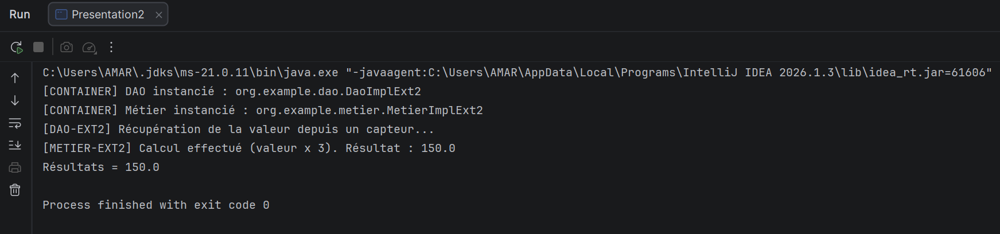
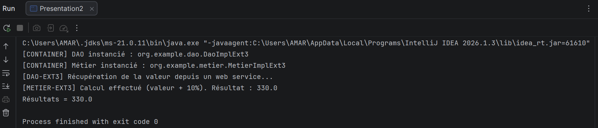
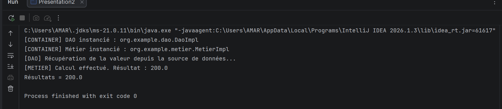

# TP1 — Programmation dynamique (Instanciation dynamique & Injection de dépendances)

Mini-conteneur d'injection de dépendances écrit en Java, **sans Spring** : les classes à utiliser sont lues dans un fichier de configuration, instanciées par **réflexion**, puis le DAO est injecté dans le métier via son **setter**.

## Principe

Le code de `Presentation2` ne connaît aucune classe concrète, seulement les interfaces `IDao` et `IMetier`. Pour changer de comportement, on modifie le fichier de configuration, **sans toucher au code ni recompiler**.

```
config.txt ──► Class.forName(...) ──► newInstance() ──► setDao(dao) ──► metier.calcul()
```

1. Lecture des noms de classes dans `config.txt` (ligne 1 : DAO, ligne 2 : métier).
2. Instanciation du DAO et du métier avec `Class.forName` + `getDeclaredConstructor().newInstance()`.
3. Injection du DAO dans le métier avec `getMethod("setDao", ...)` + `invoke`.
4. Appel de `metier.calcul()` et affichage du résultat.

## Structure du projet

```
src/main/java/org/example/
├── dao/
│   ├── IDao.java            interface (getValue)
│   ├── DaoImpl.java         version de base       → 100
│   ├── DaoImplExt2.java     extension 2 (capteur) → 50
│   └── DaoImplExt3.java     extension 3 (web service) → 300
├── metier/
│   ├── IMetier.java         interface (calcul)
│   ├── MetierImpl.java      version de base       → valeur × 2
│   ├── MetierImplExt2.java  extension 2           → valeur × 3
│   └── MetierImplExt3.java  extension 3           → valeur + 10 %
└── presentation/
    └── Presentation2.java   « conteneur » : lecture config, réflexion, injection
config.txt                   configuration active
config-ext2.txt              configuration de l'extension 2
config-ext3.txt              configuration de l'extension 3
```

## Configuration

Le fichier `config.txt` contient deux lignes : le DAO, puis le métier.

| Version | Ligne 1 (DAO) | Ligne 2 (Métier) | Résultat attendu |
|---|---|---|---|
| Base | `org.example.dao.DaoImpl` | `org.example.metier.MetierImpl` | 100 × 2 = **200.0** |
| Extension 2 | `org.example.dao.DaoImplExt2` | `org.example.metier.MetierImplExt2` | 50 × 3 = **150.0** |
| Extension 3 | `org.example.dao.DaoImplExt3` | `org.example.metier.MetierImplExt3` | 300 × 1,1 = **330.0** |

## Exécution

**Méthode 1 — modifier `config.txt`** : remplacer les deux lignes par celles de l'extension voulue, puis lancer `Presentation2`.

**Méthode 2 — passer le fichier en argument** : lancer `Presentation2` avec `config-ext2.txt` ou `config-ext3.txt` en *Program arguments*. Sans argument, `config.txt` est utilisé.

> Le *Working directory* doit être la racine du projet, sinon le fichier de configuration est introuvable.

## Résultats

### Version de base (`DaoImpl` + `MetierImpl`)


### Extension 2 (`DaoImplExt2` + `MetierImplExt2`)


### Extension 3 (`DaoImplExt3` + `MetierImplExt3`)


## Remarque

Le même programme produit trois résultats différents uniquement en changeant la configuration : c'est le principe de l'**inversion de contrôle** (IoC) et de l'**injection de dépendances**, que Spring automatise.
